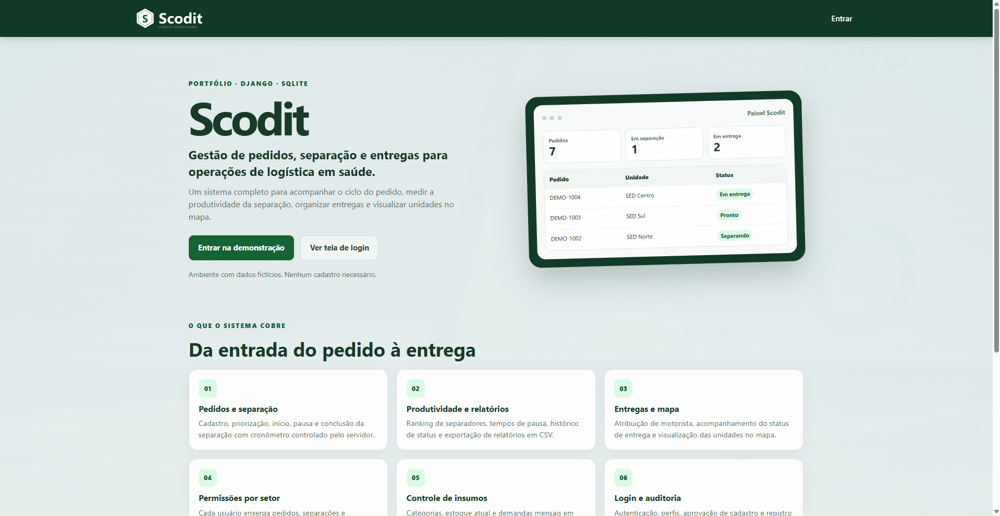

# Scodit — Gestão de Operações Logísticas

Sistema web desenvolvido com Django para organizar e acompanhar processos de separação de pedidos em operações logísticas.

O Scodit tem como objetivo centralizar informações, facilitar a distribuição de atividades e oferecer visibilidade sobre o andamento das separações.

## Demonstração online

**[Acessar o Scodit](https://sabrinagama.alwaysdata.net/)**

Versão demonstrativa com dados fictícios e informações anonimizadas, disponível para explorar as funcionalidades do sistema.

## Funcionalidades

- **Gestão de pedidos:** cadastro e acompanhamento dos pedidos de separação.
- **Gestão de unidades:** cadastro administrativo das unidades e suas informações.
- **Atribuição de responsáveis:** associação de separadores aos pedidos.
- **Acompanhamento de atividades:** visualização dos pedidos em andamento, pausados ou concluídos.
- **Controle de pausas:** registro e acompanhamento do tempo de pausa durante uma separação.
- **Visualização geográfica:** exibição das unidades em mapas.

## Tecnologias

- Python
- Django
- HTML
- CSS
- JavaScript
- Leaflet
- CARTO Voyager

## Objetivo do projeto

O Scodit foi desenvolvido para explorar soluções de software aplicadas a processos logísticos, com foco na organização de tarefas, no acompanhamento operacional e na centralização de informações.

O desenvolvimento envolve a aplicação de conceitos de desenvolvimento web, estruturação de funcionalidades, gerenciamento de dados e construção de interfaces para diferentes perfis de utilização.

## Imagens

## Sobre o código-fonte

Este repositório apresenta a documentação e a descrição do projeto. O código-fonte não está disponível publicamente.

---

# Scodit — Logistics Operations Management

A web application developed with Django to organize and monitor order-picking processes in logistics operations.

Scodit aims to centralize information, simplify task assignment, and provide visibility into the progress of picking activities.

## Live Demo

**[Access Scodit](https://sabrinagama.alwaysdata.net/)**

A demonstration version with fictional data and anonymized information, available for exploring the system's features.

## Features

- **Order management:** registration and tracking of picking orders.
- **Unit management:** administrative registration of operational units and their information.
- **Task assignment:** assignment of picking operators to orders.
- **Activity tracking:** monitoring of orders that are in progress, paused, or completed.
- **Pause management:** recording and tracking of pause time during picking activities.
- **Geographic visualization:** displaying operational units on maps.

## Technologies

- Python
- Django
- HTML
- CSS
- JavaScript
- Leaflet
- CARTO Voyager

## Project Purpose

Scodit was developed to explore software solutions for logistics processes, focusing on task organization, operational tracking, and information centralization.

The project involves applying web development concepts, structuring application features, managing data, and building interfaces for different user roles.

## Screenshots

## Source Code

This repository contains the project's documentation and overview. The source code is not publicly available.
